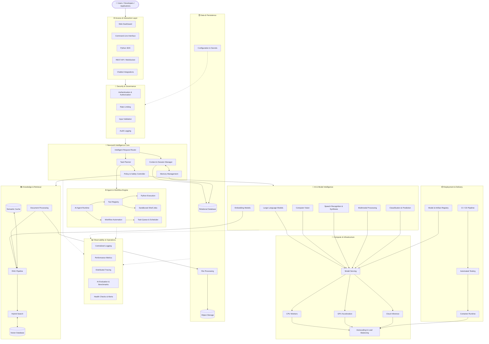
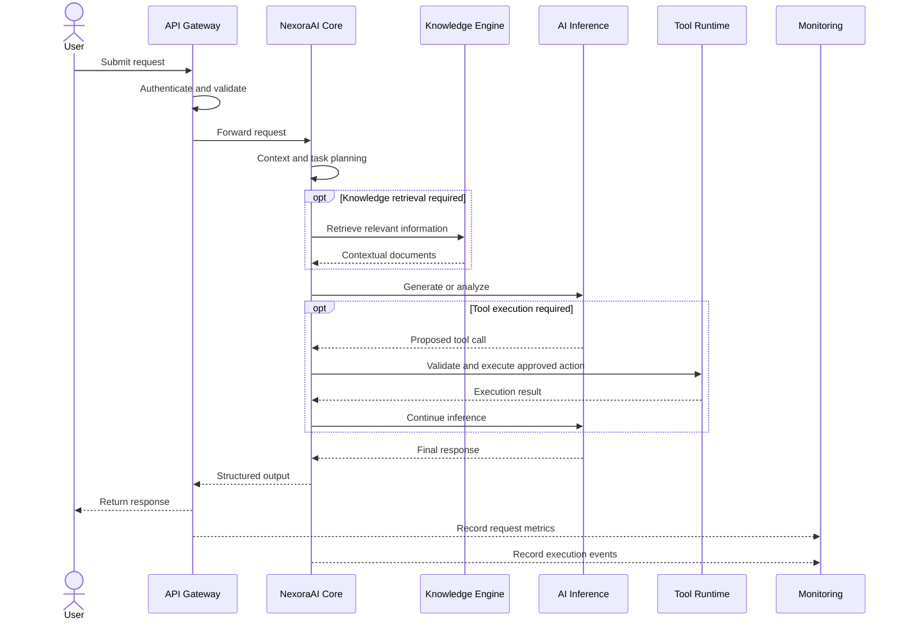

# model-Ai
# 🧠 MarketAI — Advanced AI System Architecture

MarketAI is envisioned as a modular artificial intelligence ecosystem integrating multimodal inference, intelligent orchestration, retrieval-augmented generation (RAG), autonomous task workflows, computational acceleration, and scalable deployment infrastructure.

## 🌐 Comprehensive AI Topology

## ✨ Core Capabilities

| Module | Features |
|---|---|
| AI Inference | LLMs, model routing, generation, classification |
| Multimodal AI | Text, image, audio, and compatible multimodal models |
| Intelligent Agents | Task planning, tool invocation, workflow orchestration |
| Knowledge Engine | RAG, embeddings, semantic search, document indexing |
| Memory System | Session context, configurable persistent memory |
| Automation | Python tools, scheduled tasks, controlled shell execution |
| Data Layer | SQL databases, vector stores, object storage |
| Compute Engine | CPU, GPU, cloud inference, model serving |
| Security | Authentication, authorization, validation, audit trails |
| Observability | Logs, metrics, tracing, evaluation, health checks |
| Deployment | Containers, CI/CD, automated tests, artifact management |

## 🔄 Intelligent Request Lifecycle

## 🛠️ Suggested Technology Stack

| Layer | Candidate Technologies |
|---|---|
| Programming | Python |
| API | FastAPI, Pydantic |
| AI Models | PyTorch, Transformers, compatible model APIs |
| RAG | LlamaIndex or LangChain |
| Vector Search | Qdrant, FAISS, or pgvector |
| Database | PostgreSQL, SQLite |
| Caching & Queues | Redis, Celery |
| GPU Serving | vLLM or compatible inference servers |
| Deployment | Docker, Linux, cloud infrastructure |
| Testing | pytest |
| Monitoring | Prometheus, Grafana, OpenTelemetry |

These technologies are optional candidates, not mandatory dependencies. Select components according to actual application requirements.

## 🔒 Security & Reliability Principles

- Enforce authentication and authorization at application boundaries.
- Isolate tool execution inside restricted environments.
- Require explicit permissions for consequential actions.
- Protect credentials using environment variables or a secrets manager.
- Validate inputs and constrain resource consumption.
- Monitor inference latency, errors, and compute utilization.
- Evaluate model outputs for quality, reliability, and safety.
- Apply data retention and privacy policies appropriate to the deployment.

## 🚀 Development Roadmap

- [ ] Core AI orchestration and API
- [ ] Pluggable model backends
- [ ] Conversation and session management
- [ ] Retrieval-augmented generation
- [ ] Document ingestion and semantic search
- [ ] Multimodal model integration
- [ ] Sandboxed tool execution
- [ ] Workflow scheduling and task queues
- [ ] GPU inference optimization
- [ ] Authentication and access control
- [ ] Automated testing and evaluation
- [ ] Monitoring and deployment automation

## 📌 Architecture Status

This topology describes a proposed extensible architecture for NexoraAI. Individual modules should be implemented, tested, and documented before being represented as available production features.

The architecture is intended to evolve incrementally, enabling experimentation with new models, computational strategies, and AI-assisted workflows without requiring the entire system to be redesigned.

**Build intelligent systems. Orchestrate computation. Engineer beyond conventional automation.**
